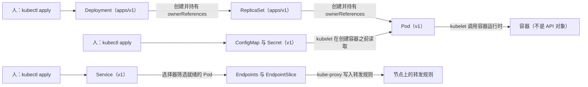

# Kubernetes 对象词典（累积维护）

> 建立日期：2026-09-22（第 2 周 Day 5 收尾时建立）。
> 建立原因：`notes/week2/day1.md` 至 `notes/week2/day5.md` 五天的笔记中，Pod、Deployment、ReplicaSet、Service、Endpoints、ConfigMap、Secret 这些对象反复出现，每天都要重新回答同一组问题并且重新抄写同一张字段清单。这种重复建设既消耗时间，也不产生新的理解，因此把这一部分内容集中到本文件，长期累积维护。
> 使用方式：某个对象第一次出现时，把它的「五问答案」与「字段清单」写入本文件；此后再次遇到同一个对象时，当天的笔记只写当天新增的字段、被实测推翻的结论、以及当天新确认的边界条件，并在笔记中注明「对象本身的概念见 `notes/k8s-对象词典.md` 的对应条目」。
> 内容来源：本文件的全部条目都取自 `notes/week2/day1.md` 至 `notes/week2/day5.md` 的实测记录，以及教材《Kubernetes in Action》中文版的对应页码。凡是标为「补充」的内容，都是我在教材原文之外为了补全机制而增加的说明；凡是标注了页码的内容，都可以回到教材原文核对。

---

## 0. 每天的维护动作

| 步骤 | 动作 | 完成标志 |
|---|---|---|
| 1 | 判断当天出现的对象是否已经存在于本文件 | 如果不存在，就按第 2 章的模板新增一个条目；如果已经存在，就不重新抄写 |
| 2 | 判断当天是否出现了新的字段、新的默认值或者新的边界条件 | 把新增的字段追加进对应条目的字段表，并且注明它是哪一天由哪一次实验确认的 |
| 3 | 判断当天是否推翻了本文件中的某一条结论 | 直接修改对应单元格的内容，并且在「修订记录」中写一行，注明被推翻的旧说法与新的实测依据 |

> 修订记录：本文件建立时收录的是 Day 1 至 Day 5 已经确认的全部结论，尚无被推翻的条目。

---

## 1. 对象总表

| 对象 | 属于哪种 API 资源 | 属于哪个层级 | 谁创建它 | 它的生命周期与谁绑定 | 主要观察命令 |
|---|---|---|---|---|---|
| Pod | `v1` 中的 Pod | 命名空间级 | 可以由人直接创建（这种 Pod 称为裸 Pod），也可以由 ReplicaSet、DaemonSet、Job 这类控制器创建 | 无论由谁创建，它都是一次性对象；由控制器创建的 Pod 在被删除之后会被控制器补齐，裸 Pod 被删除之后不会恢复 | `kubectl get po -o wide`、`kubectl describe po <名称>` |
| Deployment | `apps/v1` 中的 Deployment | 命名空间级 | 由人执行 `kubectl apply` 创建 | 与所在命名空间绑定，只有执行 `kubectl delete deploy` 才会消失；升级与回滚都不会删除这个对象 | `kubectl get deploy`、`kubectl rollout history deploy/<名称>` |
| ReplicaSet | `apps/v1` 中的 ReplicaSet | 命名空间级 | 由 Deployment 控制器创建 | 由 Deployment 通过 `metadata.ownerReferences` 字段持有；Deployment 被删除时它会被级联删除，被缩容到 0 的旧 ReplicaSet 则保留下来用于回滚 | `kubectl get rs`、`kubectl describe rs <名称>` |
| Service | `v1` 中的 Service | 命名空间级 | 由人执行 `kubectl apply` 或 `kubectl expose` 创建 | 与 Pod 的生死完全无关，Pod 反复重建期间 Service 对象的内容保持不变 | `kubectl get svc`、`kubectl describe svc <名称>` |
| Endpoints 与 EndpointSlice | `v1` 中的 Endpoints，以及 `discovery.k8s.io/v1` 中的 EndpointSlice | 命名空间级 | 当 Service 带有选择器时，由 `kube-controller-manager` 中的端点控制器创建；当 Service 不带选择器时，必须由人创建 | 与同名的 Service 一起存在，内容随 Pod 的创建、删除与就绪状态变化而频繁更新 | `kubectl get endpoints <服务名称>`、`kubectl get endpointslices -o wide` |
| ConfigMap | `v1` 中的 ConfigMap | 命名空间级 | 由人创建 | 与 Pod 无关；删除它不会影响已经运行的容器，但会让新建的 Pod 停在 `CreateContainerConfigError` | `kubectl get cm`、`kubectl describe cm <名称>` |
| Secret | `v1` 中的 Secret | 命名空间级 | 由人创建 | 与 ConfigMap 相同 | `kubectl get secret`、`kubectl get secret <名称> -o yaml` |
| 容器 | 不是 API 资源，容器没有 `kind`，也无法执行 `kubectl get` 列出 | 不适用 | 由 Pod 所在节点上的 kubelet 调用节点内部的容器运行时创建 | 随 Pod 一起被创建与删除；容器退出之后是否重启由 Pod 的 `spec.restartPolicy` 字段决定 | `kubectl logs <Pod 名称>`、`docker ps`（在节点内部） |
| 探针 | 不是 API 资源，它是 Pod 模板中容器下面的三个并列字段 | 命名空间级（随 Pod 定义存在于某个命名空间中） | 由人写在 Pod 模板中，再经 Deployment 的模板传给 ReplicaSet，最后经 ReplicaSet 的模板传给每一个 Pod | 与容器绑定：容器被重启时探针的计时重新开始，Pod 被重建时同样重新开始 | `kubectl describe po <名称>` 输出中的 `Liveness` 与 `Readiness` 段落 |
| `revision` 与 `generation` | 不是对象，它们分别是写在注解与元数据中的两个计数 | 不适用 | 由 Deployment 控制器与 API Server 分别写入 | `revision` 在 Pod 模板每次变更时新增一个编号，编号一去不复返；`generation` 在 `spec` 每次变更时递增 | `kubectl get deploy <名称> -o yaml`、`kubectl rollout history deploy/<名称>` |

---

## 2. 逐对象条目

### 2.1 Pod

| 问题 | 答案 |
|---|---|
| 它是什么类型的 API 资源 | 内置资源（`apiVersion: v1`、`kind: Pod`），内容是一份「若干容器共享若干命名空间、并且必须运行在同一个节点上」的声明；同时它是 Kubernetes 中最小的可调度单位 |
| 它属于哪个层级 | 命名空间级对象，因此 `kubectl get po` 默认只列出当前命名空间中的 Pod |
| 谁创建它 | 可以由人直接创建，这种 Pod 称为裸 Pod；也可以由控制器创建，例如 ReplicaSet、DaemonSet、Job。由控制器创建时，`metadata.ownerReferences` 字段会指向创建它的控制器对象，这是判断「这个 Pod 属于谁」的权威依据 |
| 它的生命周期与谁绑定 | 它是一次性对象：删除它等价于新建一个全新的 Pod，名称与 IP 地址都会改变。可以被重启的只有容器这一层，表现为 `RESTARTS` 这一列的计数增加，Pod 对象本身不会重启。需要补一个限定条件：`status.podIP` 在生命周期内保持不变的前提是沙箱不被重建，节点上的容器运行时重启会重建沙箱并重新分配地址，判断依据是事件中的 `SandboxChanged`，而此时 Pod 的 `uid` 与 `metadata.creationTimestamp` 仍然不变（该限定条件由 Day 2 的实测确认） |
| 它不是什么 | 它不是容器。一个 Pod 可以包含多个容器，这些容器共享 Network、UTS、IPC 三种命名空间（p.109-110），因此共用同一个 IP 地址、同一个主机名与同一个端口空间，但它们的文件系统默认互相隔离，需要共享目录时必须显式挂载卷 |

| 字段 | 类别 | 含义与取值 |
|---|---|---|
| `apiVersion: v1` 与 `kind: Pod` | 必填 | 声明这是一个 Pod 对象 |
| `metadata.name` | 必填（与 `metadata.generateName` 二者取一） | Pod 的名称；由控制器创建时，名称的结构是 `<控制器名称>-<随机后缀>` |
| `metadata.namespace` | 可选 | 省略时使用当前上下文的命名空间 |
| `metadata.labels` | 可选 | 供标签选择器匹配使用；ReplicaSet 判断「这个 Pod 是否属于我」时同时依据标签与 `ownerReferences` 两个信息 |
| `metadata.ownerReferences` | 服务端写入 | 一个对象创建另一个对象时由 API Server 自动写入，指向拥有者；Pod 的拥有者是 ReplicaSet，ReplicaSet 的拥有者是 Deployment |
| `spec.containers[]` | 必填 | 容器列表；它下面的常用子字段是 `name`（必填，并且在 Pod 内唯一）、`image`（必填）、`ports[].containerPort`（只是声明，不产生任何网络规则）、`env`、`volumeMounts`、`command` 与 `args`、`resources`、`livenessProbe`、`readinessProbe` 与 `startupProbe` |
| `spec.restartPolicy` | 可选，默认值为 `Always` | 容器退出之后的处理方式，取值可以是 `Always`、`OnFailure`、`Never`；执行这个动作的是容器所在节点上的 kubelet |
| `spec.nodeName` | 通常省略，由调度器写入 | Pod 被调度到哪一个节点；手写清单时通常不写这个字段，一旦写死，调度器就不再参与选择 |
| `spec.volumes[]` | 可选 | Pod 级的卷声明，可以被同一个 Pod 内的多个容器同时挂载，这是同一个 Pod 内多个容器共享文件的方式（第 3 周介绍） |
| `spec.dnsPolicy` | 可选，默认值为 `ClusterFirst` | 域名解析策略，它决定容器内的 `/etc/resolv.conf` 指向 CoreDNS，还是沿用节点上的解析配置 |
| `spec.terminationGracePeriodSeconds` | 可选，默认值为 30 | 删除 Pod 时，kubelet 先向容器的主进程发送 TERM 信号，等待这段时间之后如果进程仍然存在，再发送 KILL 信号 |
| `spec.serviceAccountName` | 可选，默认值为 `default` | Pod 用哪一个 ServiceAccount 的身份访问 API Server；因此每个 Pod 默认会挂载一个令牌卷（第 5 周介绍） |
| `status` | 服务端写入 | 由 kubelet 上报、由 API Server 写入；常用子字段是 `phase`、`podIP`、`hostIP`、`startTime`、`conditions[]`（其中 `Ready` 表示是否通过就绪判定）与 `containerStatuses[].restartCount`（也就是 `RESTARTS` 这一列的来源） |

#### 2.1.1 Pod 内部容器的共享范围（Day 1 实测结论）

| 问题 | 答案 |
|---|---|
| 「Pod 是调度单位」这句话的推论是什么 | 调度器以 Pod 为对象选择节点，因此同一个 Pod 内的全部容器必然位于同一个节点上，无法被拆分到两个节点 |
| 同一个 Pod 内的容器共享哪些命名空间 | 共享 Network、UTS、IPC 三种命名空间，因此共用同一个 IP 地址、同一个主机名与同一个端口空间 |
| 同一个 Pod 内的容器不共享什么 | 默认不共享 PID 命名空间与文件系统，因此进程之间互不可见，文件系统互相隔离；需要共享目录时必须显式挂载卷 |
| 同一个 Pod 内的两个容器能绑定同一个端口吗 | 不能，因为端口空间是共用的，第二个容器绑定该端口时会返回地址已被占用的错误 |
| 不同 Pod 的端口会冲突吗 | 不会，因为每个 Pod 拥有独立的网络命名空间，端口空间彼此独立 |

### 2.2 Deployment

| 问题 | 答案 |
|---|---|
| 它是什么类型的 API 资源 | 内置资源（`apiVersion: apps/v1`、`kind: Deployment`），内容是一份「某个版本的 Pod 应该运行多少个副本」的声明，并且负责在版本发生变化时以滚动方式替换副本（p.413-438） |
| 它属于哪个层级 | 命名空间级对象 |
| 谁创建它 | 由人执行 `kubectl apply` 创建 |
| 它的生命周期与谁绑定 | 与所在命名空间绑定，只有显式执行删除命令才会消失；升级与回滚都不会删除它 |
| 它不是什么 | 它不直接创建 Pod。它创建 ReplicaSet，再由 ReplicaSet 创建 Pod，因此从提交到运行一共存在四层对象：Deployment → ReplicaSet → Pod → 容器。它也不是版本历史的存放处，历史版本表现为被缩容到 0 的旧 ReplicaSet |

| 字段 | 类别 | 含义与取值 |
|---|---|---|
| `apiVersion: apps/v1` 与 `kind: Deployment` | 必填 | 声明这是一个 Deployment 对象 |
| `metadata.name` | 必填 | Deployment 的名称，它同时是它创建的 ReplicaSet 名称的前缀 |
| `metadata.namespace` | 可选 | 省略时使用当前上下文的命名空间 |
| `spec.replicas` | 可选，默认值为 1 | 期望的副本数量；实际的增减由 ReplicaSet 控制器执行 |
| `spec.selector` | 必填，并且创建之后不可修改 | 用来判断哪些 Pod 属于本次部署；控制器会在它之上追加 `pod-template-hash` 标签，再把选择器交给 ReplicaSet |
| `spec.template` | 必填 | Pod 模板；其中的 `metadata.labels` 必须与 `spec.selector` 匹配，否则 API Server 会拒绝创建 |
| `spec.strategy` | 可选，默认值为 `RollingUpdate` | 升级方式；`RollingUpdate` 的两个子字段是 `maxSurge` 与 `maxUnavailable`，默认值都是 25%（p.426）；取值为 `Recreate` 时先删除全部旧 Pod 再创建新的 |
| `spec.revisionHistoryLimit` | 可选，默认值为 10 | 保留多少个旧 ReplicaSet 用于回滚；Day 5 把它设为 5 时，版本历史恰好保留 6 条记录，也就是 1 个当前版本加 5 个历史版本 |
| `spec.minReadySeconds` | 可选，默认值为 0 | 一个新的 Pod 需要保持就绪多少秒之后，才被算作本次升级取得的进展 |
| `spec.progressDeadlineSeconds` | 可选，默认值为 600 | 一次升级最多允许持续多少秒；超过这个时间之后，控制器把 `Progressing` 条件写成 `False` 并且原因为 `ProgressDeadlineExceeded`，但控制器不会自动回滚 |
| `spec.paused` | 可选，默认值为 `false` | 取值为 `true` 时控制器不推进升级；由 `kubectl rollout pause` 与 `kubectl rollout resume` 修改 |
| `status` | 服务端写入 | 由控制器写入；常用子字段是 `replicas`、`readyReplicas`、`updatedReplicas`、`availableReplicas`、`unavailableReplicas`、`observedGeneration` 与 `conditions[]`（其中 `Available` 与 `Progressing` 两个条件的取值用于判断升级是否被阻止） |

### 2.3 ReplicaSet

| 问题 | 答案 |
|---|---|
| 它是什么类型的 API 资源 | 内置资源（`apiVersion: apps/v1`、`kind: ReplicaSet`），职责是持续对账，让「匹配选择器的 Pod 数量」始终等于 `spec.replicas`（p.183） |
| 它属于哪个层级 | 命名空间级对象 |
| 谁创建它 | 由 Deployment 控制器创建，名称由「Deployment 名称 + Pod 模板的哈希值」拼成，因此可以直接从名称中看出它承载的是哪一份 Pod 模板 |
| 它的生命周期与谁绑定 | 由 Deployment 通过 `metadata.ownerReferences` 持有，Deployment 被删除时它会被级联删除；`revisionHistoryLimit` 决定最多保留几个旧 ReplicaSet |
| 它不是什么 | 它不是一次升级的日志；回滚能够选中它，是因为控制器把它缩容到 0 而不是把它删除，而它自身保存着一份完整的 Pod 模板 |

| 字段 | 类别 | 含义与取值 |
|---|---|---|
| `apiVersion: apps/v1` 与 `kind: ReplicaSet` | 必填 | 声明这是一个 ReplicaSet 对象 |
| `spec.replicas` | 可选，默认值为 1 | 期望的 Pod 副本数量 |
| `spec.selector` | 必填 | 标签选择器，可以写成 `matchLabels` 形式，也可以写成表达力更强的 `matchExpressions` 形式（p.185）；由 Deployment 创建时，其中会多出 `pod-template-hash` 这一项 |
| `spec.template` | 必填 | Pod 模板，包括标签与容器定义；模板发生变化时会触发 Pod 的替换 |
| `metadata.annotations.deployment.kubernetes.io/revision` | 服务端写入 | 由 Deployment 控制器写在 ReplicaSet 上，表示这个 ReplicaSet 对应第几个版本 |
| `status` | 服务端写入 | 常用子字段是 `replicas`、`fullyLabeledReplicas`、`readyReplicas`、`availableReplicas` 与 `observedGeneration` |

### 2.4 Service

| 问题 | 答案 |
|---|---|
| 它是什么类型的 API 资源 | 内置资源（`apiVersion: v1`、`kind: Service`），内容是一份「一组 Pod 的稳定访问入口」的声明，而不是一个正在运行的进程 |
| 它属于哪个层级 | 命名空间级对象，因此同一个名称可以在不同命名空间中重复使用，DNS 名称也必须带上命名空间这一段 |
| 谁创建它 | 由人执行 `kubectl apply` 或 `kubectl expose` 创建 |
| 它的生命周期与谁绑定 | 与 Pod 无关；在 Pod 与 ReplicaSet 反复重建的过程中，Service 对象一直存在并且内容不变，只有显式执行删除命令时它才消失 |
| 它不是什么 | 它不执行健康检查，它内部没有任何探针配置；它也不理解 HTTP，因为它工作在第 4 层，只依据 IP 地址与端口转发数据包，需要按主机名或者路径路由时必须引入 Ingress；它更不是转发组件，真正写入转发规则的是每个节点上的 kube-proxy |

| 字段 | 类别 | 含义与取值 |
|---|---|---|
| `apiVersion: v1` 与 `kind: Service` | 必填 | 声明这是一个 Service 对象 |
| `metadata.name` | 必填 | Service 的名称，它同时决定 DNS 名称的第一段，也就是 `<名称>.<命名空间>.svc.cluster.local`，取值必须符合 DNS 标签规则 |
| `metadata.namespace` | 可选 | 省略时使用当前上下文的命名空间；与之配套的端点对象必须位于同一个命名空间中 |
| `metadata.labels` 与 `metadata.annotations` | 可选 | 用于标记 Service 对象自身；它与 `spec.selector` 的作用完全不同，前者是给这个对象贴标签，后者是筛选后端 Pod |
| `spec.type` | 可选，默认值为 `ClusterIP` | 取值范围是 `ClusterIP`、`NodePort`、`LoadBalancer`、`ExternalName` |
| `spec.selector` | 可选 | 一个键值映射形式的标签选择器；如果省略该字段，Kubernetes 就不会自动创建 Endpoints 对象，必须由人工创建（p.222-224） |
| `spec.ports[]` | 必填 | 端口列表；子字段分别是 `name`（在同一个 Service 声明多个端口时必填）、`port`（必填，客户端访问本 Service 时使用的端口）、`targetPort`（可选，省略时默认与 `port` 相同）、`protocol`（可选，默认值为 `TCP`）、`nodePort`（仅在 NodePort 与 LoadBalancer 类型下可用，省略时由 API Server 在 30000 至 32767 之间自动分配） |
| `spec.clusterIP` | 服务端分配 | 虚拟 IP 地址；把它显式写成 `None` 时创建出来的是 Headless Service，此时 DNS 会直接返回各个 Pod 的地址（p.254） |
| `spec.sessionAffinity` | 可选，默认值为 `None` | 取值为 `ClientIP` 时，同一个客户端 IP 发起的连接总是被转发到同一个 Pod（p.233） |
| `spec.externalTrafficPolicy` | 可选 | 仅在 NodePort 与 LoadBalancer 类型下有意义；取值为 `Local` 时只把流量转发到本节点上的 Pod |
| `spec.publishNotReadyAddresses` | 可选，默认值为 `false` | 取值为 `true` 时，尚未通过就绪判定的 Pod 也会被写入端点列表，Headless Service 与 StatefulSet 的场景会用到它（p.257） |
| `status` | 服务端写入 | 由 Kubernetes 写入并持续更新，例如 LoadBalancer 类型下的 `status.loadBalancer.ingress`；手写清单时必须删除这个段落 |

### 2.5 Endpoints 与 EndpointSlice

| 问题 | 答案 |
|---|---|
| 它是什么类型的 API 资源 | Endpoints 是 `v1` 中的内置资源，EndpointSlice 是 `discovery.k8s.io/v1` 中的内置资源；两者保存的内容都是「某个 Service 的后端地址清单」，也就是当前可以接收流量的真实地址与端口 |
| 它属于哪个层级 | 命名空间级对象 |
| 谁创建它 | 当 Service 带有选择器时，由 `kube-controller-manager` 中的端点控制器自动创建；当 Service 不带选择器时，控制器不会创建它，必须由人创建同名的对象（p.222-224） |
| 它的生命周期与谁绑定 | 与同名的 Service 一起存在；Pod 被创建、被删除、就绪状态发生变化或者标签发生变化时，端点集合都随之更新（p.524）。删除 Service 时同名的 Endpoints 对象会随之被删除 |
| 它不是什么 | 它不是负载均衡器，转发动作由每个节点上的 kube-proxy 依据它来更新规则；它也不是 Service 的属性，教材原文是「Endpoint 是一个单独的资源，并不是服务的一个属性」（p.223）；客户端不会直接读取它，读取它的是 kube-proxy 与 CoreDNS |

| 字段 | 类别 | 含义与取值 |
|---|---|---|
| `metadata.name` | 必填 | 必须与它所属的 Service 名称完全相同，`kubectl get endpoints <服务名称>` 这条命令正是依赖这个约定 |
| `metadata.namespace` | 必填 | 必须与它所属的 Service 位于同一个命名空间 |
| `subsets[]` | 可选（由控制器填充） | 一个端点分组；同一个分组内的全部地址共用这一组端口声明，因此同一组地址必须监听相同的端口 |
| `subsets[].addresses[]` | 服务端写入 | 当前处于就绪状态、可以接收流量的地址；其中 `ip` 是必填项，`hostname`、`nodeName`、`targetRef` 是可选字段，`targetRef` 通常指向这个地址对应的 Pod 对象 |
| `subsets[].notReadyAddresses[]` | 服务端写入 | 尚未通过就绪判定的地址；默认情况下这些地址不会出现在 `addresses` 中，因此不会收到流量，只有把 `spec.publishNotReadyAddresses` 设为 `true` 时它们才被视为可用（p.257） |
| `subsets[].ports[]` | 服务端写入 | 这一组地址上开放的端口；其中 `name` 用于与 Service 中多端口声明的 `name` 逐项对应，`port` 是实际的端口号，`protocol` 是协议 |

| 情形 | 谁维护端点对象 | 结果 |
|---|---|---|
| Service 带有选择器 | 端点控制器自动维护 | Pod 被创建、被删除、就绪状态发生变化、标签发生变化时，端点集合都随之更新 |
| Service 不带选择器 | 控制器不创建，由人创建同名的 Endpoints 对象 | 可以把自己维护的一组地址（例如集群外部的数据库地址）登记进来，Service 的虚拟地址就对这组外部地址做转发；默认命名空间中的 `kubernetes` 这个 Service 就属于这种用法 |
| 原本不带选择器，之后又加上了选择器 | 端点控制器接管 | 反过来把选择器从 Service 中移除之后，Kubernetes 就会停止更新端点对象（p.224）；这个特性正是「对外地址保持不变，而服务的实现方式发生改变」的实现手段 |

### 2.6 ConfigMap

| 问题 | 答案 |
|---|---|
| 它是什么类型的 API 资源 | 内置资源（`apiVersion: v1`、`kind: ConfigMap`），内容是若干条「键 → 字符串取值」的记录；它没有进程，也不监听端口 |
| 它属于哪个层级 | 命名空间级对象，因此 Pod 只能引用同一个命名空间中的 ConfigMap，跨命名空间引用是不允许的 |
| 谁创建它 | 由人创建（执行 `kubectl create` 或 `kubectl apply`），也可以用 `kubectl create configmap --from-literal` 直接创建 |
| 它的生命周期与谁绑定 | 与 Pod 无关；删除它不会删除 Pod，也不会影响已经运行的容器，但会让新建的 Pod 因为找不到对象而停在 `CreateContainerConfigError` |
| 它不是什么 | 它不是卷、不是环境变量、也不是加密容器；它只是一份键值数据，「怎么进入容器」完全由 Pod 模板决定，同一个 ConfigMap 可以被多个 Pod 以不同方式引用 |

| 字段 | 类别 | 含义与取值 |
|---|---|---|
| `apiVersion: v1` 与 `kind: ConfigMap` | 必填 | 声明这是一个 ConfigMap 对象 |
| `metadata.name` | 必填 | 对象的名称，Pod 模板通过这个名称引用它 |
| `metadata.namespace` | 可选 | 省略时使用当前上下文的命名空间；引用它的 Pod 必须位于同一个命名空间 |
| `metadata.labels` 与 `metadata.annotations` | 可选 | 用于标记这个对象自身，它与 Deployment 的选择器没有关系 |
| `data` | 与 `binaryData` 二者取其一 | 字符串键值对；取值必须是字符串，因此 `listen_port: 8080` 会被拒绝，必须写成带引号的 `"8080"` 或者用块标量 |
| `binaryData` | 与 `data` 二者取其一 | 二进制内容，取值必须是 base64 编码的字符串 |
| `immutable` | 可选，默认值为 `false` | 取值为 `true` 时对象的内容不可再修改 |
| `status` | 不存在 | ConfigMap 没有 `status` 段落，这一点与 Deployment 不同 |

### 2.7 Secret

| 问题 | 答案 |
|---|---|
| 它是什么类型的 API 资源 | 内置资源（`apiVersion: v1`、`kind: Secret`），结构上与 ConfigMap 相同，也是键值记录 |
| 它属于哪个层级 | 命名空间级对象，必须与引用它的 Pod 位于同一个命名空间 |
| 谁创建它 | 由人创建 |
| 它的生命周期与谁绑定 | 与 ConfigMap 相同；删除它不会影响已经运行的容器，但会让新建的 Pod 停在 `CreateContainerConfigError` |
| 它与 ConfigMap 的差别是什么 | 三个差别：第一，条目内容以 base64 编码存放在 `data` 段落中；第二，分发范围受控，只有真正使用它的节点才会拿到内容，内容保存在内存文件系统（tmpfs）中而不写入节点磁盘，单个体积上限为 1 MB（p.346）；第三，可以被单独授权，RBAC 可以只授予读取 Secret 的权限，而不授予读取其他对象的权限 |
| 它是不是加密存储的 | 不是。base64 只是编码，取出 `data` 的取值之后执行 `base64 -d` 就能还原出明文；真正的保护手段是访问控制与传输加密 |
| 它不是什么 | 它不是密钥管理系统，不提供凭证轮换、审计与自动过期；生产环境的凭证通常来自外部密钥管理系统，Secret 只承担传输介质 |
| 谁把它送进容器 | 与 ConfigMap 相同，由 Pod 所在节点上的 kubelet 在创建容器之前读取并写入 |

| 字段 | 类别 | 含义与取值 |
|---|---|---|
| `apiVersion: v1` 与 `kind: Secret` | 必填 | 声明这是一个 Secret 对象 |
| `metadata.name` | 必填 | 对象的名称，Pod 模板通过这个名称引用它 |
| `metadata.namespace` | 可选 | 省略时使用当前上下文的命名空间 |
| `type` | 可选，默认值为 `Opaque` | 其他常见取值是 `kubernetes.io/tls`（存放证书与私钥）、`kubernetes.io/dockerconfigjson`（拉取私有镜像时使用）、`kubernetes.io/service-account-token`（服务账户令牌） |
| `data` | 与 `stringData` 二者取其一 | 取值必须是已经 base64 编码的字符串；`kubectl create secret generic` 生成的模板就是这个段落 |
| `stringData` | 只写字段 | 写入时给出明文，API Server 在保存之前把它编码进 `data`；读回时这个段落已经消失，只剩下 `data` |
| `immutable` | 可选，默认值为 `false` | 取值为 `true` 时对象的内容不可再修改 |
| `status` | 不存在 | Secret 没有 `status` 段落 |

### 2.8 Pod 模板中引用 ConfigMap 与 Secret 的字段（Day 3 新增）

| 字段 | 类别 | 含义与取值 |
|---|---|---|
| `spec.template.spec.containers[].envFrom[]` | 可选 | 一次注入被引用对象中的全部键；列表中的每一项要么是 `configMapRef`，要么是 `secretRef`，两者不能合并写在同一个列表项里 |
| `envFrom[].configMapRef.name` 与 `envFrom[].secretRef.name` | 引用时必须 | 被引用对象的名称，必须位于同一个命名空间并且已经存在 |
| `envFrom[].prefix` | 可选 | 给注入的每个键名加上统一前缀，例如写成 `CONFIG_` 之后得到 `CONFIG_GREETING` |
| `containers[].env[].valueFrom.configMapKeyRef` 与 `.secretKeyRef` | 与 `env` 的 `value` 二者取其一 | 逐条注入指定的键，可以配合 `optional: true` 让缺少该键时不阻止容器启动 |
| `containers[].volumeMounts[]` | 与 `volumes[]` 成对出现 | 容器级字段，说明把卷挂到容器内的哪个路径；`subPath` 一旦出现，`mountPath` 必须指向文件 |
| `volumes[].configMap.name` | 引用 ConfigMap 时必须 | 被挂载的 ConfigMap 对象名称 |
| `volumes[].secret.secretName` | 引用 Secret 时必须 | 被挂载的 Secret 对象名称；字段名是 `secretName`，而不是 `configMap` 那种 `name` |
| `volumes[].configMap.items` 与 `volumes[].secret.items` | 可选 | 只暴露指定的键，并把键名映射成指定的文件名 |
| `volumeMounts[].readOnly` | 可选 | 取值为 `true` 时卷以只读方式挂载 |
| `volumes[].configMap.defaultMode` 与 `volumes[].secret.defaultMode` | 可选，默认值为 `0644` | 卷内文件的权限；收紧权限时要同时考虑卷内文件的属主（默认是 root）与容器进程的 uid |

### 2.9 三种探针（不是对象，是容器下面的三个并列字段）

| 探针 | 字段路径 | 一句话定义 | 它回答的问题 | 连续失败达到阈值之后 kubelet 的动作 | 来源 |
|---|---|---|---|---|---|
| 存活探针 | `spec.containers[].livenessProbe` | 它是判断「容器是否还需要继续运行」的检查字段 | 这个容器还需要继续运行吗 | 终止容器主进程，并在同一个 Pod 内重新创建一个全新的容器 | 教材 4.1 节（p.155-161） |
| 就绪探针 | `spec.containers[].readinessProbe` | 它是判断「Pod 是否已经可以接收流量」的检查字段 | 这个 Pod 现在可以接收流量吗 | 不重启容器，只把 Pod 的 `Ready` 条件写成 `False`，控制平面据此把该地址移出端点列表 | 教材 5.5 节（p.247-253） |
| 启动探针 | `spec.containers[].startupProbe` | 它是判断「容器的主进程是否已经启动完成」的检查字段 | 这个容器的主进程启动完成了吗 | 只在启动阶段计时：在它第一次成功之前另外两个探针都不会被执行；如果它在 `failureThreshold` 与 `periodSeconds` 的乘积之内始终没有成功，则终止容器并重新创建 | 补充：Kubernetes 1.16 作为 alpha 引入，1.18 升为 beta，1.20 正式可用 |

| 字段 | 类别 | 含义与取值 |
|---|---|---|
| `httpGet.path` | 使用 HTTP 检查时必填 | 请求的路径，本次存活探针使用 `/healthz`，就绪探针使用 `/readyz`；不写则为空字符串 |
| `httpGet.port` | 使用 HTTP 检查时必填 | 容器内监听的端口，本次为 `8080`；它与 Service 的端口无关，不写则 API Server 拒绝清单 |
| `httpGet.scheme` | 可选，默认值为 `HTTP` | 协议，取 `HTTP` 或 `HTTPS` |
| `httpGet.httpHeaders` | 可选，默认值为空列表 | 附加的请求头 |
| `tcpSocket.port` | 使用 TCP 检查时必填 | 尝试建立连接的容器端口 |
| `exec.command` | 使用命令检查时必填 | 在容器内执行的命令，退出码为 0 时判定成功 |
| `initialDelaySeconds` | 可选，默认值为 `0` | 容器创建之后等待多少秒才开始第一次探测；本次存活探针为 5，就绪探针为 2 |
| `periodSeconds` | 可选，默认值为 `10` | 每隔多少秒探测一次；本次两种探针都是 5，这样第一次失败到容器被重启的耗时由约 30 秒缩短到约 15 秒 |
| `timeoutSeconds` | 可选，默认值为 `1` | 单次探测的响应超时时间 |
| `failureThreshold` | 可选，默认值为 `3` | 连续失败多少次判定为失败 |
| `successThreshold` | 可选，默认值为 `1` | 连续成功多少次判定为恢复；存活探针与启动探针的该字段只允许取 1 |
| `terminationGracePeriodSeconds` | 可选，默认值遵循 Pod 级设置 | 探针导致的终止所使用的宽限期 |

---

## 3. 对象之间的托管关系

### 3.1 谁在什么时候读取哪一份数据

| 关系 | 由哪个组件负责建立 | 依据哪个字段 | 效果 |
|---|---|---|---|
| Deployment 到 ReplicaSet | Deployment 控制器 | `spec.template` 与 `spec.selector`，并且为自己创建的 ReplicaSet 生成带 `pod-template-hash` 的名称与标签 | 模板变化时创建新的 ReplicaSet，旧 ReplicaSet 被缩容到 0 而不是被删除 |
| ReplicaSet 到 Pod | ReplicaSet 控制器 | `spec.selector`（其中包含 `pod-template-hash`）与 `spec.template` | 匹配选择器的 Pod 数量持续等于 `spec.replicas` |
| Service 到 Endpoints | 端点控制器 | `spec.selector` 与每个 Pod 的 `Ready` 条件 | Pod 就绪状态变化时端点列表随之更新 |
| Endpoints 到转发规则 | 每个节点上的 kube-proxy | 端点对象中的地址与端口 | 发往 ClusterIP 的连接被转发到端点列表中的某一个地址 |
| ConfigMap 与 Secret 到容器 | Pod 所在节点上的 kubelet | Pod 模板中的 `envFrom`、`valueFrom`、`volumes[]` 与 `volumeMounts[]` | 以环境变量方式注入时在容器创建时写入一次，以卷挂载方式注入时写入文件并随对象内容变化而更新 |

---

## 4. 手写清单时应当省略哪些字段

| 应当省略的字段 | 省略的原因 | 需要写出该字段的情形 |
|---|---|---|
| `status` 以及它下面的全部子字段 | 它由控制器与 kubelet 写入，手写清单中携带它会在执行 `kubectl apply` 时报错或者被忽略 | 不需要写出，任何情况下都省略 |
| `metadata.ownerReferences` | 它由 API Server 在控制器创建下级对象时自动写入 | 手动构造子对象的情形极少，日常不需要写 |
| `metadata.uid`、`metadata.creationTimestamp`、`metadata.resourceVersion`、`metadata.generation` | 这些字段由 API Server 生成与维护 | 不需要写出 |
| `metadata.namespace` | 省略时使用当前上下文的命名空间 | 需要在与当前上下文不同的命名空间中创建对象时写出 |
| `spec.nodeName` | 省略时由调度器选择节点；一旦写死，调度器就不再参与选择 | 只在刻意绕过调度器、把 Pod 固定到某个节点时写出 |
| `spec.selector` | Deployment 与 ReplicaSet 的该字段是必填项，不能省略；Pod 自身没有选择器字段 | 不需要写出，但必须保证它匹配 Pod 模板中的标签 |
| 探针中的 `scheme`、`httpHeaders`、`timeoutSeconds`、`successThreshold`、`failureThreshold` 与 `initialDelaySeconds` | 这些字段都有默认值，由 API Server 在存储之前补全 | 只在需要偏离默认值时写出，例如为了缩短观察窗口而把 `periodSeconds` 写成 5 |
| Service 中的 `spec.clusterIP` 与 `spec.ports[].nodePort` | 由 API Server 分配，写成 `None` 会创建 Headless Service | 只在刻意要求 Headless Service 或者固定 NodePort 时写出 |

## 5. 字段查询工具（不需要记忆的部分放回工具里）

| 场景 | 命令 | 说明 |
|---|---|---|
| 查询某个字段的含义、类型与是否必填 | `kubectl explain deploy.spec.strategy.rollingUpdate` | 逐层展开字段文档，输出中 `-required-` 标记必填字段，`-optional-` 标记可选字段 |
| 查询某个字段的默认值 | `kubectl explain deploy.spec.strategy --recursive` | 递归列出全部子字段及其类型，用于确认字段的完整结构 |
| 只生成清单而不创建资源 | `kubectl create deploy webapp --image=webapp:v7 --dry-run=client -o yaml` | 把 API Server 补全默认值之后的结果输出到标准输出，用来核对哪些字段属于必填、哪些字段属于默认值 |
| 查看对象当前的实际取值 | `kubectl get deploy webapp -o yaml` | 输出中包含 `status` 段落与全部被补全的默认值，这是核对清单与实际状态是否一致的依据 |
| 查看对象变化过程中的取值 | `kubectl get rs -w` | 持续输出变化，用于观察副本数量在升级过程中的增减顺序 |
