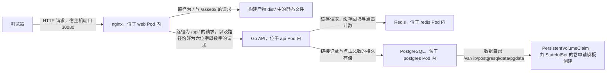

# 短链接服务项目 · 实施方案（可迁移）

> 编写日期：2026-09-27。
> 编写原因：你决定更换工作目录之后再开始编码，因此把已经确定的设计、分工、接口契约、阶段划分、文件清单与环境前提集中写入本文件。你把本文件连同第 0 节列出的两个文件一起复制到新目录之后，可以直接从阶段 1 开始，不需要重新讨论设计。
> 本文件与项目内的 `README.md` 的关系：本文件是「实施方案」，说明做什么、谁做、按什么顺序做、怎么验收；项目内的 `README.md` 是「设计文档」，说明系统结构、接口契约与数据模型。两份文件中的接口契约内容必须保持一致，如果后续需要修改接口，两份文件要同时修改。

---

## 0. 已经生成的文件，以及需要一起迁移的文件

| 文件 | 当前状态 | 说明 | 迁移时如何处理 |
|---|---|---|---|
| `code/shortener/README.md` | 已完成 | 项目的设计文档，包含系统结构图、四个组件的职责表、数据模型、七个接口的契约、Redis 键的设计、目录结构与六个阶段的目标 | 复制到新目录的根目录，改名为 `README.md` |
| `code/shortener/compose.yaml` | 已完成 | 本地联调清单，当前只包含 PostgreSQL 与 Redis 两个服务，阶段 3 时再补上后端与前端两个服务 | 复制到新目录的根目录 |
| `plan/短链接服务项目-方案.md` | 本文件 | 实施方案，也就是你现在读到的这一份 | 复制到新目录的 `docs/` 目录下，或者与项目一起放在根目录 |

> 迁移之后，代码仓库中的既有资料（例如 `docs/k8s_in_action/`、`notes/`、`plan/`）是否一起迁移，由你决定。如果不迁移，那么本文件第 11 节列出的教材与笔记路径在新目录中会失效，你只需要保留本文件中的结论部分即可。

---

## 1. 项目的目标与验收标准

| 项 | 内容 |
|---|---|
| 一句话目标 | 用 Go 写一个短链接服务，用 Vue 写它的管理页面，用 PostgreSQL 保存链接记录，用 Redis 承担读取缓存与点击计数，把四个组件分别以容器方式部署到 kind 集群上运行 |
| 最终验收标准 | ① 在浏览器上打开集群暴露的地址，能够创建一个短链接；② 把浏览器地址改成 `http://<地址>/<短码>` 之后能够跳转到原始长网址；③ 删除 `postgres-0` 这个 Pod，等待集群重建它之后，此前创建的短链接仍然能够跳转；④ 执行扩容之后 `api` 的副本数量变为 3，页面上的统计条仍然能够正常显示数据 |
| 与学习计划的关系 | 本项目的阶段 4 与阶段 5 覆盖 `plan/week3/任务明细.md` 中的「卷与持久化」「StatefulSet 概览」「requests 与 limits」三部分内容；阶段 6 覆盖「Pod 起不来的四类原因」；第 4 周的 CI/CD 阶段将以本项目的两个镜像作为构建产物 |
| 与简历的关系 | 本项目同时是 `plan/求职学习计划.md` 第 1 节中「阶段 2 部署到 Kubernetes」与「阶段 3 数据持久化与故障排查」两个阶段的实际载体，完成后可以写进简历的「项目经历」部分 |

---

## 2. 分工约定（依据你的原话确定）

| 交付物 | 由谁编写 | 我提供什么 | 你负责什么 |
|---|---|---|---|
| 前端代码（`web/` 目录） | 由我全部编写 | 全部源文件、开发模式代理配置、生产模式 nginx 配置、多阶段构建的 Dockerfile | 读懂 `web/nginx.conf` 中的两条反向代理规则，因为第 4 周的 Ingress 清单要处理同一件事 |
| 后端代码（`api/` 目录） | 由你编写 | 分步指引（每一步的目标、机制说明、关键提示、验收方式）、`go.mod` 的依赖清单、目录结构 | 按步骤写出代码，每写完一个接口立刻用 `curl` 验证，把与预期不符的地方记进笔记 |
| Kubernetes 清单（`k8s/` 目录） | 由你编写 | 每个清单的骨架文件、需要你回答的提示问题、每类对象的字段清单指引 | 填写字段、执行 `kubectl apply`、观察结果、把结论写进笔记 |
| 笔记与对象词典 | 由你编写 | 每天给出笔记骨架与需要填写的问题 | 按 `AGENTS.md` 中「笔记的固定结构」的要求填写四块内容 |

> 这条分工的判定标准是：凡是「与 Kubernetes 学习强相关」的内容由你写，凡是「与 Kubernetes 学习无关的样板代码」由我写。Vue 组件与 nginx 配置属于样板代码，因此由我写；后端的服务启动流程与数据访问属于样板代码，但它同时也承担「就绪探针要检查什么」这个知识点的载体，因此由你写；K8s 清单属于学习目标本身，因此全部由你写。

---

## 3. 系统结构与四个组件

### 3.1 结构图



### 3.2 组件表

| 组件 | 技术选型 | 工作负载形态 | 副本数 | 是否需要持久化 | 服务类型 | 镜像标签 |
|---|---|---|---|---|---|---|
| 前端 | Vue 3 与 Vite，生产环境由 nginx 提供静态文件 | Deployment | 2 | 不需要，静态文件已经打进镜像 | NodePort，宿主机端口 30080 | `shortener-web:v1` |
| 后端 | Go 1.22 以上的标准库 `net/http`，加 `pgx/v5` 与 `go-redis/v9` | Deployment | 2 | 不需要，后端的全部状态都在 PostgreSQL 与 Redis 中 | ClusterIP，只在集群内部可见 | `shortener-api:v1` |
| 数据库 | PostgreSQL 16 | StatefulSet | 1 | 需要，卷申请模板为 `postgres-0` 单独申请一份存储 | Headless Service，名称为 `postgres` | `postgres:16-alpine` |
| 缓存 | Redis 7 | Deployment | 1 | 不需要，缓存全部丢失的后果只是重定向时回落到数据库 | ClusterIP，名称为 `redis` | `redis:7-alpine` |

> 关于「后端为什么可以有 2 个副本而数据库只有 1 个副本」：后端是无状态服务，任意一个副本都能够独立处理任意请求，因为它不保存任何只属于自己的数据；PostgreSQL 在本项目中以单实例方式运行，多个副本会带来主从复制与故障转移的问题，这超出了本项目的范围，因此把副本数固定为 1，并在面试中如实说明这是一项刻意的简化。

### 3.3 请求在不同路径上的流转

| 浏览器发起的请求 | 第一步由谁处理 | 第二步由谁处理 | 最终结果 |
|---|---|---|---|
| `GET /` | nginx 在 `web` Pod 内读取 `/usr/share/nginx/html/index.html` | 不再向后转发 | 返回单页应用的 HTML，浏览器加载其中的 JavaScript 之后由 Vue 渲染页面 |
| `GET /api/links?limit=50` | nginx 依据 `location /api/` 规则执行反向代理 | `api` Pod 内的 Go 进程查询 PostgreSQL，返回 JSON | 页面得到短链接列表 |
| `POST /api/links` | nginx 依据 `location /api/` 规则执行反向代理 | `api` Pod 内的 Go 进程生成短码、写入 PostgreSQL、删除同名缓存键 | 页面得到新建的短链接 |
| `GET /a1B2c3` | nginx 依据正则位置规则 `^/[A-Za-z0-9]{6}$` 执行反向代理 | `api` Pod 内的 Go 进程先查 Redis，未命中再查 PostgreSQL，然后执行 `302` 跳转并累加点击计数 | 浏览器跳转到原始长网址 |
| `GET /assets/index-a1b2c3.js` | nginx 依据 `location /assets/` 规则直接读取磁盘上的文件 | 不再向后转发 | 浏览器得到前端构建产物，也就是带哈希值后缀的静态文件 |

---

## 4. 接口契约（前端与后端共同遵守，不得单方面修改）

全部接口的前缀都是 `/api`，请求体与响应体的字符编码都是 UTF-8，`Content-Type` 都是 `application/json`。

| 方法 | 路径 | 请求体或查询参数 | 成功响应 | 失败响应 |
|---|---|---|---|---|
| `GET` | `/api/healthz` | 无 | `200` 与 `{"status":"ok"}` | 无失败分支，它只证明 Go 进程还能够响应请求 |
| `GET` | `/api/readyz` | 无 | `200` 与 `{"status":"ready","checks":{"postgres":"ok","redis":"ok"}}` | PostgreSQL 或 Redis 任一不可用时返回 `503` 与 `{"status":"not ready","checks":{"postgres":"fail","redis":"ok"}}` |
| `POST` | `/api/links` | `{"url":"https://example.com/very/long"}` | `201` 与 `{"code":"a1B2c3","url":"https://example.com/very/long","clicks":0,"createdAt":"2026-09-27T10:00:00Z"}` | 参数不合法时返回 `400` 与 `{"error":"..."}` |
| `GET` | `/api/links` | 查询参数 `limit`（默认 20，上限 100）与 `offset`（默认 0） | `200` 与 `{"items":[{"code":"...","url":"...","clicks":0,"createdAt":"..."}],"total":42,"limit":20,"offset":0}` | 参数不是整数时返回 `400` 与 `{"error":"..."}` |
| `DELETE` | `/api/links/{code}` | 无 | `204`，响应体为空 | 短码不存在时返回 `404` 与 `{"error":"短码不存在"}` |
| `GET` | `/api/stats` | 无 | `200` 与 `{"links":42,"clicks":1234,"cacheHits":900,"cacheMisses":100,"cacheHitRate":0.9}` | 依赖不可用时返回 `503` |
| `GET` | `/{code}` | 无 | `302`，响应头中的 `Location` 字段为原始长网址 | 短码不存在时返回 `404` |

### 4.1 错误响应的统一结构

| 触发条件 | HTTP 状态码 | 响应体 |
|---|---|---|
| 请求体不是合法的 JSON | `400` | `{"error":"请求体不是合法的 JSON"}` |
| `url` 字段缺失，或者去掉首尾空格之后是空字符串 | `400` | `{"error":"url 字段不能为空"}` |
| `url` 字段不以 `http://` 或者 `https://` 开头 | `400` | `{"error":"url 字段必须以 http:// 或 https:// 开头"}` |
| `url` 字段的长度超过 2048 个字符 | `400` | `{"error":"url 字段长度超过 2048"}` |
| `limit` 或者 `offset` 不是整数 | `400` | `{"error":"limit 与 offset 必须是整数"}` |
| 请求的短码在数据库中不存在 | `404` | `{"error":"短码不存在"}` |
| PostgreSQL 或者 Redis 不可用，并且该请求需要访问它们 | `503` | `{"error":"依赖服务不可用"}` |
| 其他未预期的错误 | `500` | `{"error":"服务器内部错误"}` |

---

## 5. 数据模型与 Redis 键的设计

### 5.1 PostgreSQL 中的表

| 列名 | 类型 | 约束 | 含义 |
|---|---|---|---|
| `code` | `varchar(16)` | 主键 | 6 位短码，字符集为 `0-9`、`a-z`、`A-Z` 共 62 个字符，因此可用的取值数量为 $62^6 \approx 5.7 \times 10^{10}$ |
| `url` | `text` | 非空 | 原始长网址 |
| `clicks` | `bigint` | 非空，默认值为 0 | 累计点击次数，由后端把 Redis 中的增量批量写回这一列 |
| `created_at` | `timestamptz` | 非空，默认值为 `now()` | 创建时间，用于列表按倒序排列 |

建表语句由后端在启动时执行，并且必须写成可以重复执行的形式：

```sql
CREATE TABLE IF NOT EXISTS links (
    code       varchar(16) PRIMARY KEY,
    url        text        NOT NULL,
    clicks     bigint      NOT NULL DEFAULT 0,
    created_at timestamptz NOT NULL DEFAULT now()
);

CREATE INDEX IF NOT EXISTS links_created_at_idx ON links (created_at DESC);
```

> 关于「短码冲突如何处理」：生成短码之后执行插入，如果 PostgreSQL 返回唯一约束冲突，也就是 SQLSTATE 取值为 `23505`，就重新生成一个短码再插入，最多重试 5 次。这条重试逻辑必须写在后端，因为短码的唯一性由数据库的主键约束保证，而不是由后端的随机数生成器保证。

### 5.2 Redis 中的键

| 键名模式 | 数据类型 | 取值内容 | 写入时机 | 生存时间 | 删除时机 |
|---|---|---|---|---|---|
| `link:{code}` | 字符串 | 原始长网址 | 重定向查询数据库命中之后回填，创建短链接时也可以主动预热 | 300 秒 | 调用删除接口时主动删除，或者到期之后由 Redis 自动删除 |
| `clicks:{code}` | 字符串，用 `INCR` 累加的整数 | 尚未写回数据库的点击增量 | 每一次成功的重定向执行一次 `INCR` | 不设置 | 后台协程把增量写回数据库并且成功之后，用 `DECRBY` 扣除已经写回的增量 |
| `stats:cache_hits` | 字符串，用 `INCR` 累加的整数 | 缓存命中次数 | 每次查询 Redis 并且命中时执行一次 `INCR` | 不设置 | 不主动删除 |
| `stats:cache_misses` | 字符串，用 `INCR` 累加的整数 | 缓存未命中次数 | 每次查询 Redis 并且未命中时执行一次 `INCR` | 不设置 | 不主动删除 |

> 关于「点击计数为什么不直接执行 `UPDATE links SET clicks = clicks + 1`」：直接更新数据库有两条代价。第一条代价是每一次重定向都要写一次数据库，热点短链会在数据库上产生行级锁竞争；第二条代价是重定向的响应时间从此被数据库的写入延迟绑定。改用 Redis 计数器加后台批量写回之后，重定向的响应时间只取决于 Redis，数据库在每一轮写回周期内承担的写入次数是固定的。这项设计的代价是「后端进程在批量写回之前被杀死」时，这一轮的增量会丢失，这一条边界条件要写进你的笔记。

### 5.3 后端使用的环境变量

| 变量名 | 默认值 | 含义 | 在 Kubernetes 中由哪个对象提供 |
|---|---|---|---|
| `PORT` | `8080` | HTTP 服务监听的端口 | ConfigMap |
| `DB_HOST` | `localhost` | PostgreSQL 的主机名 | ConfigMap，取值是 PostgreSQL 的 Service 名称 |
| `DB_PORT` | `5432` | PostgreSQL 的端口 | ConfigMap |
| `DB_USER` | `shortener` | 连接数据库使用的用户名 | ConfigMap |
| `DB_NAME` | `shortener` | 使用的数据库名称 | ConfigMap |
| `DB_PASSWORD` | 无，必须由调用方提供 | 连接数据库使用的密码 | Secret，取值来自 `stringData` 或者 `kubectl create secret generic` 的 `--from-literal` |
| `DB_SSLMODE` | `disable` | libpq 的传输加密模式，集群内部通信使用 `disable` | ConfigMap |
| `REDIS_ADDR` | `localhost:6379` | Redis 的地址 | ConfigMap |
| `REDIS_PASSWORD` | 空字符串 | Redis 的密码，本项目不使用密码 | 不注入 |
| `CACHE_TTL_SECONDS` | `300` | 缓存键的生存时间 | ConfigMap |
| `FLUSH_INTERVAL_SECONDS` | `3` | 点击增量写回数据库的周期 | ConfigMap |

> 关于环境变量的设计原则：敏感性决定它放进 Secret 还是 ConfigMap，而不是重要性决定。密码放进 Secret 的原因是它与 ConfigMap 的存储方式与访问控制不同；主机名、端口、周期这类取值放进 ConfigMap 的原因是修改它们不需要重新构建镜像，也不需要重新签发密钥。

---

## 6. 新目录中使用的目录结构

```text
<新目录>/
├── README.md                      项目的设计文档，包含系统结构、接口契约与数据模型
├── compose.yaml                   本地联调清单，阶段 1 只启用 postgres 与 redis，阶段 3 再补 api 与 web
├── docs/
│   └── 短链接服务项目-方案.md      本文件
├── web/                           前端，由我编写
│   ├── package.json
│   ├── vite.config.js
│   ├── index.html
│   ├── nginx.conf
│   ├── Dockerfile
│   ├── .dockerignore
│   ├── .gitignore
│   └── src/
│       ├── main.js
│       ├── App.vue
│       ├── api.js
│       ├── styles.css
│       └── components/
│           ├── StatsBar.vue
│           ├── LinkForm.vue
│           └── LinkList.vue
├── api/                           后端，由你编写，分步指引见 api/TASKS.md
│   ├── go.mod
│   ├── main.go
│   ├── Dockerfile
│   ├── .dockerignore
│   └── internal/
│       ├── config/config.go
│       ├── store/postgres.go
│       ├── cache/redis.go
│       ├── httpapi/router.go
│       ├── httpapi/handlers.go
│       └── counters/flusher.go
└── k8s/                           Kubernetes 清单，由你编写，指引见 k8s/README.md
    ├── 00-namespace.yaml
    ├── 01-configmap.yaml
    ├── 03-postgres-service.yaml
    ├── 04-postgres-statefulset.yaml
    ├── 05-redis-deployment.yaml
    ├── 06-redis-service.yaml
    ├── 07-api-deployment.yaml
    ├── 08-api-service.yaml
    ├── 09-web-deployment.yaml
    ├── 10-web-service.yaml
    └── README.md                  清单填写指引，包含需要你回答的提示问题
```

> 关于命名：清单文件的编号前缀表示「阅读顺序」，而不是「执行顺序」。Kubernetes 会把一份清单内或者一次 `kubectl apply -f <目录>` 中的全部对象一起提交，对象之间的依赖关系由控制器通过重试来收敛，而不是由提交顺序决定。编号的作用是让你在阅读目录时能够按逻辑顺序展开。

---

## 7. 前端文件清单（共 13 个文件，全部由我编写）

| 文件 | 职责 | 需要你理解的要点 |
|---|---|---|
| `web/package.json` | 声明依赖与两个脚本，依赖只有 `vue`、`vite` 与 `@vitejs/plugin-vue` 三项 | 前端不需要任何 UI 组件库，因为样式由 `styles.css` 手写 |
| `web/vite.config.js` | 配置开发服务器的端口与反向代理规则，配置构建产物输出到 `dist` | 这是「开发模式下的反向代理」，与生产环境 `nginx.conf` 中的规则必须等价 |
| `web/index.html` | 单页应用的宿主页面，它只包含一个 `#app` 挂载点与一个模块脚本 | Vue 的页面结构全部由 JavaScript 在运行时生成 |
| `web/src/main.js` | 创建 Vue 应用并且挂载到 `#app` | 无 |
| `web/src/api.js` | 封装 `fetch`，向上层暴露 6 个函数，统一处理非 2xx 状态码与 204 空响应 | 接口地址使用相对路径 `/api`，这样开发与生产两种环境可以使用同一份代码 |
| `web/src/App.vue` | 顶层组件，负责调用接口、维护状态、定时刷新，并把数据分发给三个子组件 | 每 10 秒自动刷新一次，因此在集群里做操作之后不必手动刷新页面 |
| `web/src/components/StatsBar.vue` | 顶部的统计条，显示短链接总数、累计点击次数、缓存命中率 | 缓存命中率的数据来自后端的 `/api/stats`，它是验证 Redis 是否真的在工作的一手依据 |
| `web/src/components/LinkForm.vue` | 提交表单，包含「以 `http://` 或 `https://` 开头」的前端校验 | 前端校验只是体验优化，后端必须重复校验一次，因为任何人都可以绕过前端直接调用接口 |
| `web/src/components/LinkList.vue` | 表格，显示短码、原始网址、点击次数、创建时间，并且提供复制与删除两个操作 | 短码一列会拼出完整的短链接地址，也就是 `window.location.origin` 加上短码 |
| `web/src/styles.css` | 全部的样式定义 | 无 |
| `web/nginx.conf` | 生产环境的反向代理配置，包含三条位置规则 | 三条规则的优先级顺序是「正则规则优先于前缀规则」，这一点必须读懂 |
| `web/Dockerfile` | 多阶段构建：第一阶段用 `node:22-alpine` 执行 `npm install` 与 `npm run build`，第二阶段用 `nginx:1.27-alpine` 只复制构建产物与配置 | 与你在第 1 周写过的 Go 多阶段构建是同一个模式 |
| `web/.dockerignore` 与 `web/.gitignore` | 排除 `node_modules` 与 `dist` | 排除 `node_modules` 可以避免把宿主机的依赖目录复制进构建上下文，这是构建速度与构建正确性的共同前提 |

---

## 8. 后端分步指引（由你编写，共 6 步）

> 详细的逐步指引会在新目录中写成 `api/TASKS.md`。下面是六个步骤的标题、目标与验收方式，你可以先按这个顺序准备，不必等指引文件。

| 步骤 | 目标 | 关键机制 | 验收方式 |
|---|---|---|---|
| 1 | 建立模块与目录骨架，声明依赖 | 模块名使用 `shortener/api`；依赖只有 `github.com/jackc/pgx/v5` 与 `github.com/redis/go-redis/v9` 两项；路由使用标准库的 `http.ServeMux`，不引入第三方路由库 | 执行 `go build ./...` 成功，`go.mod` 中没有多余依赖 |
| 2 | 实现配置读取 | 全部配置来自环境变量，每一项都要有默认值，只有 `DB_PASSWORD` 没有默认值 | 不设置任何环境变量时进程仍然能够启动，并且在日志中打印出全部生效的配置 |
| 3 | 实现数据库连接与建表 | 使用 `pgxpool` 建立连接池；建表语句使用 `CREATE TABLE IF NOT EXISTS`；连接池的建立必须使用带超时的 `context`，否则数据库尚未就绪时进程会一直阻塞 | 启动之后用 `psql` 或者 `kubectl exec` 能看到 `links` 表已经存在 |
| 4 | 实现 Redis 客户端与四个键的操作 | `link:{code}` 的读写与回填、`clicks:{code}` 的累加、两个统计计数器的累加 | 用 `redis-cli KEYS '*'` 能够看到这四类键 |
| 5 | 实现七个 HTTP 处理器 | 短码生成使用 `crypto/rand` 而不是 `math/rand`；短码冲突时捕获 SQLSTATE 为 `23505` 的错误并重试；就绪检查必须真正执行一次 `SELECT 1` 与一次 `PING` | 用 `curl` 依次验证第 4 节表格中的七个接口，其中就绪检查在停掉 Redis 之后必须返回 `503` |
| 6 | 实现后台写回协程与优雅关闭 | 写回协程按 `FLUSH_INTERVAL_SECONDS` 的周期运行；收到 `SIGTERM` 时先停止接收新请求，再执行一次写回，然后退出；这一条直接对应 30 秒的 `terminationGracePeriodSeconds` | 对进程发送 `SIGTERM` 之后，日志中应当出现一次写回记录，并且此前累加的点击数没有丢失 |

> 步骤 5 与步骤 6 是本项目后端部分的两个学习重点：就绪检查决定「Pod 什么时候被加入 Service 的端点列表」，优雅关闭决定「Pod 被删除时正在处理的请求与尚未写回的计数会发生什么」，这两个知识点在纸上很难讲清楚，写一次代码就能够理解。

---

## 9. Kubernetes 清单清单与需要你回答的提示问题（由你编写）

| 清单文件 | 包含的对象 | 在填写之前需要回答的提示问题 |
|---|---|---|
| `00-namespace.yaml` | Namespace | 命名空间级对象与集群级对象的分界线在哪里，为什么 PostgreSQL 的 Service 属于前者 |
| `01-configmap.yaml` | ConfigMap | 第 5.3 节表格中的哪些变量放进 ConfigMap，哪些放进 Secret，判断依据是哪一个属性 |
| Secret（不写入 YAML 文件） | Secret | 为什么本项目的做法是用 `kubectl create secret generic` 直接从命令行创建，而不是把密码写进 YAML 文件再提交到仓库 |
| `03-postgres-service.yaml` | Headless Service | `clusterIP: None` 会产生什么后果，为什么 StatefulSet 必须配一个 Headless Service，普通 Service 能否代替它 |
| `04-postgres-statefulset.yaml` | StatefulSet | `serviceName` 字段指向谁，`volumeClaimTemplates` 与 Pod 模板中的 `volumes` 有什么区别，`PGDATA` 变量为什么要指向数据目录下的一个子目录 |
| `05-redis-deployment.yaml` 与 `06-redis-service.yaml` | Deployment 与 Service | Redis 的 Service 名称必须是 `redis`，它的选择器匹配的是哪一组标签 |
| `07-api-deployment.yaml` | Deployment | 存活探针指向 `/api/healthz` 而就绪探针指向 `/api/readyz`，如果把就绪探针也改成 `/api/healthz` 会发生什么；如果把存活探针改成 `/api/readyz` 而 PostgreSQL 短暂不可用，会发生什么 |
| `08-api-service.yaml` | Service | 这个 Service 不需要对外暴露，因此类型保持默认值 `ClusterIP`，它的名称 `api` 与 nginx 配置中的 `proxy_pass` 地址是什么关系 |
| `09-web-deployment.yaml` 与 `10-web-service.yaml` | Deployment 与 NodePort 类型的 Service | `nodePort` 字段的取值范围是多少，为什么是 30080 而不是 80 |
| `11-ingress.yaml`（可选，第 4 周再做） | Ingress | 用 Ingress 代替 NodePort 之后，「六位短码路径转发到后端、其余路径返回单页应用」这条规则要写在 Ingress 的哪两个字段上 |

### 9.1 镜像送入 kind 集群的方式

| 步骤 | 命令 | 说明 |
|---|---|---|
| 1 | `docker build -t shortener-api:v1 ./api` | 在本地构建后端镜像 |
| 2 | `docker build -t shortener-web:v1 ./web` | 在本地构建前端镜像 |
| 3 | `kind load docker-image shortener-api:v1 shortener-web:v1` | 把两个镜像导入 kind 节点。命令执行之后镜像才存在于节点上，在此之前 Pod 会报 `ErrImagePull` |
| 4 | `kubectl config current-context` | 确认当前上下文指向 kind 集群，避免把清单提交到别的集群 |

> 关于镜像标签与拉取策略：两个镜像的标签都使用 `v1` 这种确定取值，而不是 `latest`。原因是 `imagePullPolicy` 的默认值取决于标签，标签是 `latest` 时默认值为 `Always`，其他情况默认值为 `IfNotPresent`。使用 `v1` 加上默认策略，Pod 会直接使用节点上已经导入的镜像；如果使用 `latest`，kubelet 会尝试到远程仓库拉取，而这个镜像在远程仓库中并不存在，因此 Pod 会停在 `ImagePullBackOff`。

---

## 10. 六个阶段的交付物与验收标准

| 阶段 | 目标 | 交付物 | 验收标准 | 预计耗时 |
|---|---|---|---|---|
| 1 | 启动两个依赖服务 | 执行 `docker compose up -d`，只启动 `postgres` 与 `redis` | `docker compose ps` 中两个服务的状态都是 `running`，并且 `docker compose exec postgres pg_isready -U shortener -d shortener` 返回成功 | 20 分钟 |
| 2 | 写完后端并在宿主机上运行 | `api/` 目录中的全部文件 | 七个接口全部通过 `curl` 验证，其中就绪检查在停掉 Redis 之后返回 `503` | 3 至 4 小时，可以拆成两天 |
| 3 | 为两个组件写 Dockerfile，并且用 Compose 把四个组件一起运行 | `api/Dockerfile`、`web/Dockerfile`，以及 `compose.yaml` 中新增的两个服务 | 浏览器访问 `http://localhost:8080` 能够完成创建与跳转，并且 `docker compose logs api` 中能够看到写回记录 | 1 小时 |
| 4 | 把四个组件部署到 kind 集群 | `k8s/` 目录中的全部清单 | `kubectl get po -n shortener` 中四个组件的 Pod 全部处于 `Running` 状态并且 `READY` 列是 `1/1` | 2 至 3 小时 |
| 5 | 验证持久化与扩容 | 第 3 周笔记中的结论与采集脚本的输出 | 删除 `postgres-0` 之后重建，此前创建的短链接仍然能够跳转；把 `api` 的副本数扩到 3 之后页面仍然正常工作 | 1 小时 |
| 6 | 制造故障并且定位 | `code/shortener/outputs/` 中的 `describe` 输出片段与一张对照表 | 镜像标签错误、就绪探针失败、数据库地址错误、内存超限四类故障都在十分钟之内定位到原因 | 2 小时 |

### 10.1 阶段 6 的故障注入清单

| 编号 | 你制造什么 | 预期出现的状态 | 需要确认的字段 |
|---|---|---|---|
| 1 | 把 `api` 的镜像标签改成不存在的取值，例如 `shortener-api:v999` | Pod 的 `STATUS` 列显示 `ErrImagePull` 或者 `ImagePullBackOff` | 事件中的 `Failed` 事件与容器状态中的 `waiting.reason` |
| 2 | 把 `api` 的 `DB_HOST` 改成一个不存在的 Service 名称 | Pod 处于 `Running` 状态，而 `READY` 列是 `0/1` | `kubectl describe po` 中的 `Readiness probe failed` 事件，以及应用日志中的连接错误 |
| 3 | 把 `web` 的就绪探针路径改成一个不存在的路径 | Pod 处于 `Running` 状态，而 `READY` 列是 `0/1`，`kubectl get endpoints web` 中不包含这个 Pod 的地址 | 端点的地址列表与服务的选择器 |
| 4 | 把 `api` 的内存 `limits` 调到低于应用正常工作所需的值 | Pod 的 `STATUS` 列显示 `OOMKilled`，`RESTARTS` 列的取值增长 | `Last State` 段落中的 `Reason` 与 `Exit Code` 两个字段 |

---

## 11. 环境前提与已知易错点

### 11.1 环境前提

| 项 | 要求 | 检查方式 |
|---|---|---|
| Kubernetes 集群 | kind 集群处于运行状态，计划中记录的节点容器名是 `kind-control-plane` | 执行 `kubectl config current-context` 与 `docker ps --filter name=kind` |
| Docker | Docker Desktop 处于运行状态。如果 `/usr/bin/docker` 是软链接而目标不存在，说明 Docker Desktop 的虚拟机没有启动 | 执行 `docker version` |
| Go 模块代理 | 使用 `GOPROXY=https://goproxy.cn,direct`，因为 `proxy.golang.org` 在当前网络环境下会超时 | 执行 `go env GOPROXY` |
| 前端依赖源 | 构建前端镜像时默认使用 `https://registry.npmmirror.com`，可以通过 Dockerfile 的 `NPM_REGISTRY` 构建参数覆盖 | 构建前端镜像时的输出 |
| kubectl 上下文 | 提交清单之前必须确认上下文指向的是 kind 集群 | 执行 `kubectl config current-context` |

### 11.2 已知易错点

| 编号 | 易错点 | 产生的原因 | 处理方式 |
|---|---|---|---|
| 1 | Pod 停在 `ImagePullBackOff` 而镜像明明已经构建成功 | kind 集群的节点是一个容器，宿主机的 Docker 镜像不会自动出现在节点内部 | 每次重新构建镜像之后都要执行一次 `kind load docker-image` |
| 2 | PostgreSQL 的 Pod 反复重启，日志中提示数据目录不为空 | 把 PersistentVolumeClaim 挂载到 `/var/lib/postgresql/data` 之后，该目录下已经存在 `lost+found` 之外的其他文件时初始化脚本会拒绝执行 | 把 `PGDATA` 环境变量的取值设置为 `/var/lib/postgresql/data/pgdata`，使实际数据放在一个子目录中 |
| 3 | 后端启动时直接崩溃，日志中提示连接被拒绝 | 后端在数据库尚未就绪时直接建立连接，并且没有重试 | 连接池的建立使用带超时的 `context`，并且把数据库连接失败视为可恢复的错误而不是致命错误 |
| 4 | 就绪探针通过，但页面上的短链接列表为空 | 就绪探针只检查了进程是否响应，没有检查依赖是否可用 | 就绪探针必须执行一次 `SELECT 1` 与一次 `PING` |
| 5 | 把存活探针指向就绪检查端点之后，数据库短暂不可用导致全部后端 Pod 被反复重启 | 存活探针的语义是「这个容器是否需要被杀死」；依赖不可用时杀死容器并不能让数据库恢复，反而会让全部副本同时消失 | 存活探针只检查进程自身，就绪探针才检查依赖 |
| 6 | 前端页面能够打开，但是列表为空并且浏览器控制台出现 `502` | nginx 配置文件中的 `proxy_pass` 地址与实际 Service 名称不一致 | nginx 中 `proxy_pass http://api:8080` 这一行里的 `api` 必须与 `08-api-service.yaml` 中 `metadata.name` 的取值完全相同，因为它是集群内部的 DNS 名称 |
| 7 | 直接访问 `/a1B2c3` 得到的是单页应用的页面而不是跳转 | nginx 中缺少针对六位短码的正则位置规则，请求被 `try_files` 回落到 `index.html` | 检查 `nginx.conf` 中的正则位置规则是否存在于实际使用的配置文件中 |
| 8 | 修改 ConfigMap 之后 Pod 中的取值没有变化 | 通过环境变量注入的配置在容器创建时固定，修改 ConfigMap 不会更新已经运行的容器 | 修改之后执行 `kubectl rollout restart deploy/api` 让 Deployment 重建 Pod；这一点与通过卷挂载的 ConfigMap 行为不同 |

> 关于第 8 条易错点：ConfigMap 以卷的方式挂载时，配置文件会在一分钟之内被自动更新；以环境变量方式注入时，容器内的取值不会变化。这个区别是第 3 周笔记必须写下来的边界条件之一。

---

## 12. 迁移到新目录之后的第一步

| 顺序 | 动作 | 完成标志 |
|---|---|---|
| 1 | 把第 0 节表格中的文件复制到新目录 | 新目录中存在 `README.md` 与 `compose.yaml` |
| 2 | 执行 `docker compose up -d`，只启动 PostgreSQL 与 Redis | `docker compose ps` 中两个服务都是 `running` |
| 3 | 告诉我新目录的绝对路径，以及是否继续使用同一个目录结构 | 我据此生成 `web/` 目录下的 13 个前端文件，以及 `api/TASKS.md` 与 `k8s/README.md` 两份指引 |
| 4 | 从阶段 2 的第 1 步开始写后端 | 每完成一步就告诉我结果，我核对实际输出与契约是否一致 |
